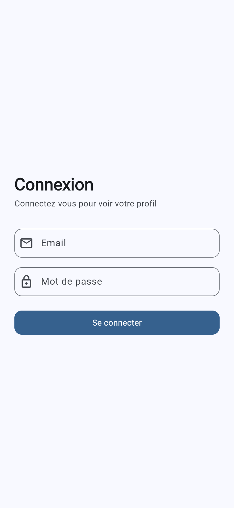
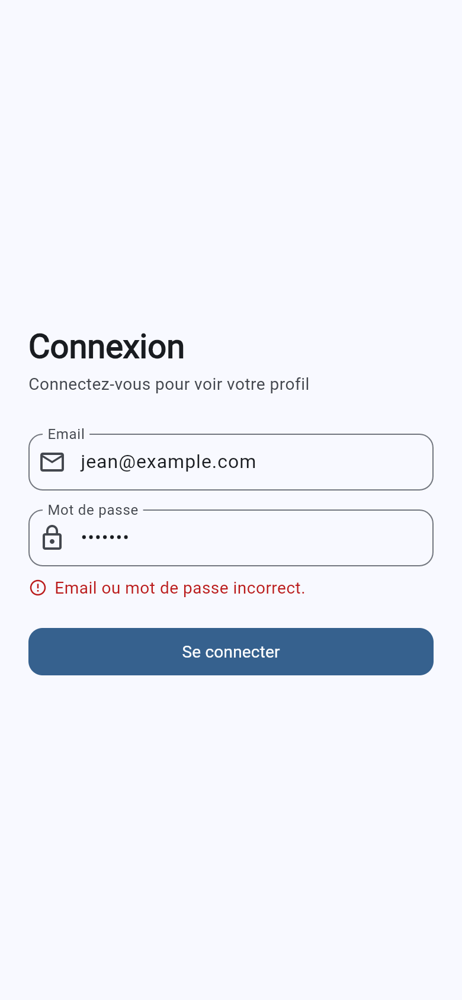
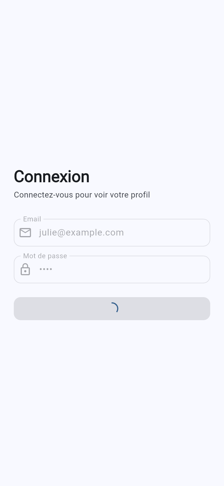
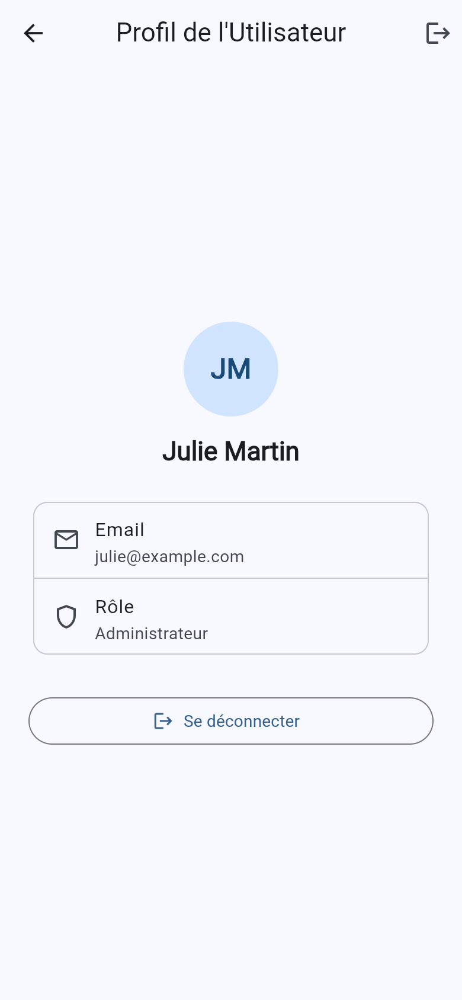

# DS Flutter : connexion via une API REST

Application Flutter de connexion qui s'authentifie auprès d'une API REST sécurisée développée pour le projet (option A du sujet). L'utilisateur saisit son email et son mot de passe, l'application les envoie en HTTPS à l'API, puis affiche son profil ou un message d'erreur.

## Captures d'écran

| Connexion | Identifiants incorrects | Chargement | Profil |
|---|---|---|---|
|  |  |  |  |

Vidéo de démonstration (format mobile) : [docs/demo.mov](docs/demo.mov)

## Fonctionnalités

- Connexion par appel HTTP `POST` à l'API (package `http`, `async`/`await`).
- Affichage du profil renvoyé par l'API : initiales, nom, email, rôle.
- Gestion des erreurs avec un message clair : identifiants incorrects, serveur injoignable, délai dépassé (10 s), réponse illisible, trop de tentatives.
- Indicateur de chargement (`CircularProgressIndicator`) dans le bouton, champs désactivés pendant l'appel.
- Interface responsive : formulaire centré et limité à 400 px de large, défilement avec `SingleChildScrollView`.
- Validation du formulaire (email au bon format, champs obligatoires).

## Sécurité

- **HTTPS** : l'API est servie en HTTPS avec un certificat local généré par [mkcert](https://github.com/FiloSottile/mkcert).
- **Mots de passe hachés** avec **bcrypt** (coût 12). bcrypt génère un **sel aléatoire** pour chaque mot de passe et l'intègre au hash : deux mots de passe identiques donnent deux hashes différents. Aucun mot de passe n'est stocké en clair.
- **Pas d'énumération des comptes** : même réponse et même temps de réponse pour un email inconnu et un mauvais mot de passe.
- **Limitation des tentatives** : 10 échecs maximum par adresse IP toutes les 15 minutes (réponse `429`).
- **Validation des entrées** côté serveur (format de l'email, longueur des champs, corps limité à 10 Ko).
- **CORS** limité aux origines `localhost` / `127.0.0.1`, en-têtes de sécurité HTTP via `helmet`.

## Structure du dépôt

```
.
├── client/             Application Flutter
│   └── lib/
│       ├── config/     URL de l'API et délai d'attente
│       ├── models/     Modèle User (construit depuis le JSON)
│       ├── screens/    Écrans de connexion et de profil
│       └── services/   AuthService : appels HTTP à l'API
├── server/             API REST Node.js + Express (détails dans server/README.md)
├── api/                Exemple PHP fourni avec le sujet (non utilisé par l'application)
└── docs/screenshots/   Captures d'écran
```

## Prérequis

| Outil | Version testée |
|---|---|
| Flutter | 3.47 (Dart 3.9 minimum) |
| Node.js | 20 minimum (testé avec 24) |
| Google Chrome | récent |
| mkcert | 1.4 |

### Installer mkcert

mkcert crée une autorité de certification locale et un certificat pour `localhost`, pour que le navigateur accepte l'API en HTTPS sans alerte.

**macOS**
```bash
brew install mkcert
```

**Windows** (PowerShell)
```powershell
winget install FiloSottile.mkcert
```
ou `choco install mkcert`.

**Linux** (Debian, Ubuntu)
```bash
sudo apt install libnss3-tools mkcert
```
Sur les autres distributions, voir les [instructions d'installation de mkcert](https://github.com/FiloSottile/mkcert#linux).

Puis, sur tous les systèmes, une seule fois :
```bash
mkcert -install
```
Cette commande ajoute l'autorité de mkcert au magasin de certificats du système (et de Chrome sous Linux). Elle peut demander le mot de passe administrateur. **Redémarrez Chrome ensuite.**

## Lancer le projet

Les commandes sont identiques sur macOS, Windows et Linux.

### 1. L'API

```bash
cd server
npm install
npm run setup
npm start
```

- `npm run setup` crée les comptes de test (mots de passe hachés) puis génère le certificat HTTPS dans `server/certs/`. À ne lancer qu'une fois.
- `npm start` démarre l'API sur `https://localhost:8443`.

Vérification : ouvrir `https://localhost:8443/login` dans Chrome doit afficher `{"status":404,...}` sans alerte de sécurité (la route n'accepte que `POST`).

### 2. L'application Flutter

Dans un second terminal :

```bash
cd client
flutter pub get
flutter run -d chrome
```

Sous Linux avec Chromium plutôt que Chrome, indiquer son chemin à Flutter :
```bash
export CHROME_EXECUTABLE=/usr/bin/chromium
```

Pour utiliser une autre API (par exemple celle fournie avec le sujet), passer l'URL complète de l'endpoint de connexion :
```bash
flutter run -d chrome --dart-define=API_URL=https://temp.itds.fr/login_tst_local.php
```

## Comptes de test

| Email | Mot de passe | Rôle |
|---|---|---|
| jean@example.com | 1234 | Utilisateur (2) |
| julie@example.com | 4321 | Administrateur (1) |

## API

`POST /login`, paramètres `email` et `password` (formulaire ou JSON).

Succès (`200`) :
```json
{
  "status": 200,
  "message": "Success",
  "id": 1,
  "firstName": "Jean",
  "lastName": "Dupont",
  "email": "jean@example.com",
  "role": 2
}
```

Erreur (`400`) :
```json
{ "status": 400, "message": "Error" }
```

Documentation complète : [server/README.md](server/README.md).

## Tests

```bash
cd server
npm test
```

```bash
cd client
flutter test test/auth_service_test.dart
```

## Dépannage

| Problème | Solution |
|---|---|
| « Impossible de joindre le serveur » dans l'app | Vérifier que `npm start` tourne, que `mkcert -install` a été lancé et que Chrome a été redémarré depuis. |
| « Trop de tentatives échouées » | Attendre 15 minutes ou redémarrer l'API (le compteur est en mémoire). |
| `mkcert est introuvable` au `npm run setup` | Installer mkcert (voir plus haut) puis rouvrir le terminal. |
| `Aucun utilisateur` au `npm start` | Lancer `npm run setup`. |
| Port 8443 déjà utilisé | `PORT=9443 npm start` (macOS, Linux) ou `$env:PORT=9443; npm start` (PowerShell), puis lancer Flutter avec `--dart-define=API_URL=https://localhost:9443/login`. |
